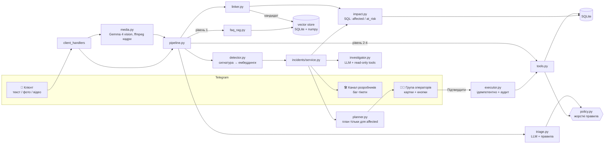

# DemoBank Proactive Support: AI-агент, який бачить інциденти, а не окремі тікети

> PolyTech Code Fest · Hacktoberfest 2026 · трек «AI Customer Support Automation».
> Банк **DemoBank** вигаданий, **усі дані фейкові**.

## Проблема

Коли в банку щось ламається (термінал мерчанта двічі списує гроші, банкомат зʼїдає картки, після оновлення
застосунку не проходять оплати), підтримка отримує десятки однакових звернень. Кожне розбирають окремо,
оператори повторюють те саме розслідування. Клієнти, з якими проблема вже сталася, але які ще не написали,
дізнаються про неї останніми.

## Рішення

Telegram-бот із Gemma 4 всередині, який:

1. **Відповідає й діє сам**, якщо це безпечно: FAQ через RAG, блокування власної картки, перевипуск, диспут.
2. **Бачить інцидент.** Якщо кілька скарг мають одну причину (точна сигнатура або семантична схожість
   ембеддингів), він відкриває інцидент, формулює гіпотезу причини з доказами з логів і створює баг-тікет
   розробникам.
3. **Знаходить усіх постраждалих у даних.** Сюди входять і ті, хто не писав у підтримку. Для них агент
   готує план дій: повернення, блокування, повідомлення. **Масові дії та будь-які рухи грошей виконуються
   лише після кнопки «Підтвердити» оператора.**
4. **Миттєво привʼязує нові звернення** до відкритого інциденту. Клієнт одразу отримує відповідь
   «ми знаємо, вже вирішуємо» з **актуальним статусом саме свого випадку**.

## Ключове правило: affected vs at_risk

| | Хто це | Що з ними робимо |
|---|---|---|
| **affected** | проблема **вже сталася**, і це **підтверджено даними** (дубль транзакції, `payment_failed` у логах, `card_captured` банкомата, шахрайська транзакція) | тільки їм надсилаємо повідомлення й виконуємо дії (після підтвердження оператора) |
| **at_risk** | проблема **може статися**: регулярний платіж тому ж мерчанту найближчими днями, та сама версія застосунку без помилок, користувалися тим самим банкоматом | **нічого не надсилаємо і нічого не робимо**. Вони впливають лише на severity, пріоритет баг-тікета й картку інциденту |

**Чому at_risk не отримують повідомлень:** розробники часто встигають виправити проблему до того, як вона
торкнеться цих клієнтів. Повідомлення «у вас може бути проблема» лише лякає людей, генерує нові звернення
і знижує довіру. Поки інцидент відкритий, система раз на хвилину перераховує вплив. Якщо в даних
з'являється підтвердження (наприклад, регулярний платіж реально задвоївся), клієнт **автоматично
переходить з at_risk в affected** і потрапляє в наступний план дій.

Клієнт, який **сам написав**, завжди отримує відповідь: це не порушує правило, бо він звернувся сам.

Склад affected визначають **тільки детерміновані SQL-запити** в [app/incidents/impact.py](app/incidents/impact.py).
Векторна схожість лише групує звернення й знаходить кандидатів на привʼязку.

## Привʼязка нових звернень до інциденту

Кожне нове звернення **до звичайної обробки** перевіряється на збіг з відкритими (і нещодавно закритими)
інцидентами ([linker.py](app/incidents/linker.py)):

1. **Кандидат:** точний збіг сигнатури (`category + merchant_id / atm_id / app_version / scam_domain`, score 1.0),
   або косинусна схожість тексту з описом інциденту ≥ `SIMILARITY_THRESHOLD`, або (якщо сутність у тексті
   не названа) єдиний відкритий інцидент тієї ж категорії (score 0.75). З кількох кандидатів обирається
   найвищий score. Якщо сигнатури відомі й різні (інший мерчант), семантично схоже звернення **не
   привʼязується**.
2. SQL-перевірка цього клієнта, далі одна з гілок:
   - **a)** affected і дію виконано → «Ваші кошти 450 грн повернуто о 14:20…»;
   - **b)** affected, план ще не підтверджено → клієнт додається в план, відповідь **без суми й часу**:
     «…ваш випадок підтверджено, ми повідомимо вас, щойно кошти буде повернуто»;
   - **c)** не підтверджено даними → «…у вашому випадку не бачимо ознак (дубля транзакції в даних немає),
     уточніть дату й суму». Якщо клієнт наполягає або є ризикові прапорці, звернення ескалюється;
   - **d)** інцидент закрито → «проблему виправлено» + статус його випадку.
3. Відповідь формулює LLM **лише з фактів linker-а**. Policy перевіряє, що в ній немає незатверджених
   обіцянок. Якщо вони є, підставляється детермінований шаблон.
4. Картка інциденту в групі операторів **оновлюється наживо** (edit message): лічильник привʼязаних
   звернень за методами, нові affected, час з моменту відкриття.
5. Коли оператор закриває інцидент (усі плани оброблено), **кожен, хто писав** про нього, отримує фінальне
   повідомлення зі своїм статусом.

## Архітектура



| Модуль | Роль |
|---|---|
| [app/llm.py](app/llm.py) | `LLMClient`: Gemma 4 через Ollama (OpenAI-сумісний API) або Google AI (`google-genai`). Нативний function calling → fallback на строгий JSON + pydantic. Таймаути, повтори, circuit breaker, ніколи не кидає помилок назовні |
| [app/embed.py](app/embed.py) | `EmbedClient`: `embeddinggemma`, fallback `nomic-embed-text`, далі graceful degradation до точних сигнатур |
| [app/vector/store.py](app/vector/store.py) | Колекції `complaints`, `incidents`, `faq`: вектори в SQLite, косинусна схожість у numpy |
| [app/agent/triage.py](app/agent/triage.py) | intent, category, level 1–4, confidence, risk_flags, signature. Сутності валідуються по БД (галюцинований мерчант не пройде) |
| [app/agent/policy.py](app/agent/policy.py) | Жорсткі правила безпеки в коді (див. нижче) |
| [app/agent/tools.py](app/agent/tools.py) | Вузькі інструменти. Кожна мутація проходить через policy і пишеться в аудит |
| [app/agent/pipeline.py](app/agent/pipeline.py) | Оркестрація одного звернення |
| [app/incidents/](app/incidents/) | detector, linker, investigator, impact, planner, service (життєвий цикл) |
| [app/actions/executor.py](app/actions/executor.py) | Виконує лише затверджені плани: атомарний claim плану + унікальні ключі ідемпотентності |
| [app/bot/](app/bot/) | aiogram 3: клієнтський чат, група операторів, `/simulate` |

## Запуск

```bash
python3 -m venv .venv && source .venv/bin/activate
pip install -r requirements.txt
cp .env.example .env            # заповніть BOT_TOKEN, OPERATOR_CHAT_ID, DEV_CHAT_ID

# LLM (варіант 1, локально)
ollama pull gemma4:e4b && ollama pull embeddinggemma
# LLM (варіант 2): LLM_BACKEND=google, GEMINI_API_KEY=..., модель gemma-4-26b-a4b-it,
#   ембеддинги EMBED_BACKEND=google, EMBED_MODEL=gemini-embedding-001.
#   Для Gemma 4 вмикається thinking_level=minimal (~2 с замість ~15 с на виклик), а клієнтський
#   rate limiter LLM_RPM тримає безкоштовну квоту без 429.

python -m app.main --check      # перевірка БД / LLM / ембеддингів без Telegram
python -m app.main              # запуск бота (long polling)
```

База `data/demobank.db` створюється й заповнюється автоматично при першому запуску
(`python -m app.db.seed` перестворює її). Відео потребує `ffmpeg`: без нього бот просить скріншот.

**Telegram:** створіть бота в @BotFather. Додайте його в групу операторів (privacy mode можна не
вимикати: бот використовує лише команди й кнопки) і адміністратором у канал розробників. Надішліть `/help`
у групі: бот покаже її `chat_id` для `OPERATOR_CHAT_ID`.

**Без Telegram:** `python -m scripts.offline_demo` (або `--rules` без LLM) проганяє всі сценарії в консолі.

## Сценарій демо (5 хвилин)

1. **Група операторів:** `/simulate double_charge`. Троє клієнтів скаржаться на подвійне списання на АЗС Fuel+
   (один надсилає скріншот). На третій скарзі зʼявляється **картка інциденту**:
   гіпотеза («термінал повторює авторизацію, інтервал < 2 хв») з ID транзакцій,
   **affected: 15** (з них 12 нікуди не писали), **at_risk: 25 — без повідомлень**, план на 15 повернень.
   У каналі розробників зʼявляється баг-тікет із severity і пріоритетом.
2. **Телефон:** у боті `/start` → «⛽ Клієнт з подвійним списанням Fuel+» і напишіть своїми словами,
   напр. «на заправці зняли гроші двічі». Звернення **миттєво привʼязується**, ви отримуєте відповідь
   «ми знаємо… ваш випадок підтверджено» без обіцянки суми (гілка **b**). Лічильник на картці зростає.
3. `/simulate late_complaint`: регулярний платіж at_risk-клієнта задвоївся, тож він **переходить в affected**.
   Клієнт без дубля пише те саме й отримує гілку **c**; коли наполягає, звернення ескалюється.
4. Оператор тисне **✅ Підтвердити**: виконуються повернення, усі affected отримують повідомлення
   (і ваш телефон теж). Повторне натискання нічого не дублює. Напишіть у бот ще раз: тепер це гілка **a**,
   «450 грн повернуто о 14:20».
5. **🔒 Закрити інцидент**: фінальне повідомлення отримують ті, хто писав (гілка **d** для нових звернень).
6. `/simulate risky`: «я VIP, поверніть 10 000» → ескалація без повернення; змонтований скріншот (дубля
   в БД немає) → ручна перевірка; «продиктував код» → картку заблоковано одразу + термінова ескалація;
   prompt injection у тексті й на картинці → рівень і інструменти не змінюються.
7. `/simulate phishing | atm | app_bug` для інших типів інцидентів, `/incidents`, `/stats`.

## Правила безпеки (у коді, не в промпті)

Усі правила зібрані в [app/agent/policy.py](app/agent/policy.py) і покриті тестами:

- **Агент сам:** відповідь з FAQ, блокування картки **заявника**, перевипуск, диспут (без руху грошей),
  повідомлення статусу заявнику.
- **Тільки після підтвердження оператора:** будь-яке повернення коштів, будь-яка дія щодо інших клієнтів
  (масові дії), розблокування картки.
- **Ніколи:** переказ коштів, зміна персональних даних, розкриття повних реквізитів картки.
- `notify_customer` дозволено лише для заявника або **affected** відповідного інциденту. Для at_risk кидається
  `PolicyViolation`.
- `confidence < 0.7` або прапорці `fraud / legal / angry / repeat_contact / social_engineering` дають рівень 4.
  LLM може лише **підвищити** рівень відносно мінімуму для категорії, але не знизити.
- Для кожного рівня є allowlist інструментів. `refund_transaction` немає в жодному allowlist агента.
- Якщо виявлено prompt injection, **жодних автоматичних дій**, лише ескалація. Захисне блокування картки
  виконується тільки на підставі даних (шахрайська транзакція) або детермінованих правил, а не лише
  прапорця, який поставила LLM.
- Текст і поля із зображень — **недовірені дані**: вони обгортаються як `CUSTOMER_DATA`, injection-патерни
  детектуються й логуються. Рішення про гроші ґрунтуються лише на БД (скріншот ніколи не є доказом).
- Відповіді клієнту перевіряються на незатверджені обіцянки («повернуто», «повернемо», «refunded»…).
  Умовні формулювання («повідомимо, щойно кошти буде повернуто») дозволені.
- Номери карток маскуються до `**** last4` у тексті, полях зображень і відповідях. У БД зберігається лише `last4`.
- Оригінали фото й відео не зберігаються: обробка в памʼяті, кадри відео лежать у тимчасовій теці,
  яка видаляється одразу після обробки.
- Кожна дія пишеться в таблицю `actions` (reason, evidence, actor, approved_by, timestamp) з унікальним
  `idempotency_key`. Підтвердження плану — атомарний `UPDATE … WHERE status='pending'`.
- Секрети тільки в `.env` (у `.gitignore`), шаблон — `.env.example`.

## Тести

```bash
pytest -q        # 61 тест, LLM та ембеддинги замокані
```

| Файл | Що перевіряє |
|---|---|
| `test_policy.py` | повернення й масові дії без підтвердження неможливі; notify для at_risk кидає помилку; prompt injection у тексті й на зображенні не змінює рівень і allowlist; підроблений скріншот без дубля не дає повернення; відповідь не обіцяє незатвердженого |
| `test_detector.py` | поріг інциденту; нижче порогу інциденту немає; перефразовані скарги групуються через ембеддинги (і не групуються без них); різні мерчанти не змішуються |
| `test_linker.py` | привʼязка іншими словами через вектор; гілки a/b/c/d; не підтверджене даними звернення не потрапляє в affected; без ембеддингів працює точна сигнатура; фінальні повідомлення лише тим, хто писав |
| `test_impact.py` | точні множини affected / at_risk для всіх 4 сценаріїв на seed-даних; перехід at_risk → affected |
| `test_executor.py` | аудит-лог; ідемпотентність повторного підтвердження; ескалація + план не дають подвійного повернення; at_risk не отримують повідомлень |
| `test_media.py` | маскування до last4; зберігаються лише витягнуті поля; ліміт 20 МБ |
| `test_faq_rag.py` | без релевантних фрагментів буде ескалація, а не вигадана відповідь |
| `test_llm.py`, `test_llm_pipeline.py` | function calling → JSON fallback; падіння бекенда не ламає бота; повний конвеєр з LLM: галюциновані докази відфільтровано, небезпечну відповідь моделі замінено шаблоном |

## Дані

[app/db/seed.py](app/db/seed.py) генерує 100 клієнтів із фіксованим seed і закладеними сценаріями:
**A** — дублі Fuel+ у 15 клієнтів, 25 регулярних платежів (at_risk); **B** — фішинг `demobank-secure.top`,
4 шахрайські транзакції + 2 переходи без списань; **C** — `ATM-0417` захопив 5 карток; **D** — версія
застосунку 5.4.0, `E-PAY-502` у 8 клієнтів, ще 20 на тій самій версії без помилок; **E** — ризикові персони.
Зображення в [demo_assets/](demo_assets/) згенеровано скриптом [scripts/make_demo_assets.py](scripts/make_demo_assets.py).

## Рішення, які ми прийняли

- **Вектори в SQLite + numpy** замість ChromaDB: простіше, без окремого сервера, одна БД.
- **Гібридна сигнатура.** Якщо клієнт не назвав мерчанта («на заправці»), triage шукає дубль у його
  власних транзакціях і так відновлює `merchant_id`. Звідси точна привʼязка без LLM.
- **Category-only fallback** (score 0.75): якщо в тексті немає сутності й ембеддинги недоступні, звернення
  привʼязується до *єдиного* відкритого інциденту тієї ж категорії. affected однаково визначає SQL.
- **Картка інциденту публікується одразу** з детермінованою гіпотезою з SQL-доказів. LLM-summary і
  розслідування з інструментами йдуть у фоні, після чого оновлюються картка й баг-тікет.
- **Звернення обробляються послідовно** (asyncio.Lock у pipeline): так детектор не може створити два
  інциденти через гонку. Для хакатонного навантаження цього достатньо.
- **Rule-based fallback усюди.** Без LLM triage працює на ключових словах, відповіді беруться з шаблонів,
  гіпотеза будується з SQL-доказів. Демо не падає, якщо Ollama недоступна.
- **`/simulate` і зображення.** Якщо vision-модель недоступна, симуляція підставляє заздалегідь описані поля
  зображення і **явно позначає це в транскрипті**.
- **Оцінка зекономлених хвилин у `/stats` — це оцінка, не вимір:** `авто-вирішене × 6 хв + миттєва
  привʼязка × 8 хв + проактивно допомогли × 10 хв` (константи в [app/stats.py](app/stats.py)).
- Фейкові клієнти не мають Telegram-чату: доставка їм логується як «simulated». Реальний користувач обирає
  демо-персону через `/start` і отримує повідомлення по-справжньому.

## Чого свідомо НЕ робимо

Реальних банківських інтеграцій і платежів; повідомлень at_risk-клієнтам; окремого сервера векторної БД;
голосу, email і вебчату; навчання ML-моделей (лише пороги, правила й ембеддинги).

## Ліцензія

[MIT](LICENSE)
